<!-- ==================== CUSTOM VECTOR HERO CARD ==================== -->
<div align="center">
  
</div>

<br/>

<!-- ==================== QUICK NAVIGATION ==================== -->
<div align="center">
  <a href="#-interface-showcase"><b>📱 Interface</b></a> &nbsp;•&nbsp;
  <a href="#-system-architecture"><b>⚙️ Architecture</b></a> &nbsp;•&nbsp;
  <a href="#-key-capabilities"><b>✨ Capabilities</b></a> &nbsp;•&nbsp;
  <a href="#-tech-stack"><b>🛠️ Tech Stack</b></a> &nbsp;•&nbsp;
  <a href="#-designed--built-by"><b>👨‍💻 Author</b></a>
</div>

<br/>

> **🔒 Read-Only Public Showcase:** Built for UI/UX review and architectural demonstration. Production source code, Firebase API credentials, and live driver PINs are maintained privately for operational security.

---

### 📱 Interface Showcase

<div align="center">

<table>
  <tr>
    <td align="center" width="33%">
      
      <br/>
      <b>🗺️ Live GPS Map &amp; Telemetry</b><br/>
      <sub>Live speed, distance, ETA, CO₂ savings &amp; 5-min alarm</sub>
    </td>
    <td align="center" width="33%">
      
      <br/>
      <b>🎛️ Commuter Hub &amp; Driver Call</b><br/>
      <sub>One-tap operator call, Day/Night mode &amp; Wake Alarm</sub>
    </td>
    <td align="center" width="33%">
      
      <br/>
      <b>📍 Scheduled Stops Timeline</b><br/>
      <sub>Stop-by-stop route progress with scheduled timings</sub>
    </td>
  </tr>
</table>

<table>
  <tr>
    <td align="center" width="50%">
      
      <br/>
      <b>🌦️ Live Route Weather &amp; Advisory</b><br/>
      <sub>Campus/route temp, humidity, wind &amp; rain traffic alerts</sub>
    </td>
    <td align="center" width="50%">
      
      <br/>
      <b>💬 Built-In Feedback &amp; Inquiry</b><br/>
      <sub>Direct commuter reporting to the transport operations team</sub>
    </td>
  </tr>
</table>

</div>

---

### ⚙️ System Architecture

```mermaid
flowchart LR
    A["🚌 Driver Console<br/>(PIN Auth + GPS)"] -->|Live Coords| B[("🔥 Firebase<br/>Realtime DB")]
    C["🗺️ OSRM Engine<br/>(Road Snapping)"] -->|Route & ETA| D["📱 Commuter App<br/>(Web + Capacitor APK)"]
    E["🌦️ Weather API<br/>(Rain Advisories)"] -->|Live Alerts| D
    B -->|Sub-Second Sync| D
    D -->|Feedback & Logs| F["📊 Transport Admin<br/>Analytics & Eco CO₂"]
